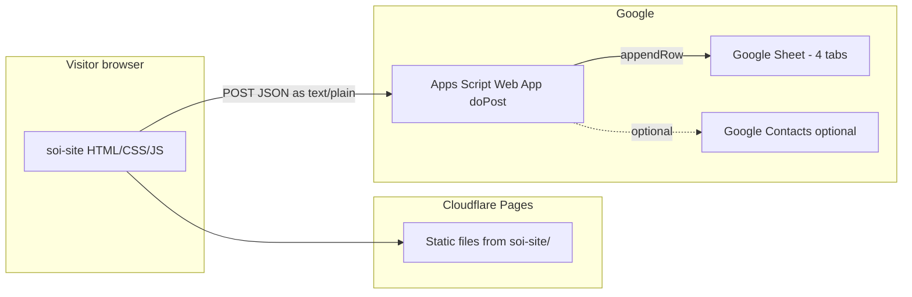

# Statement of Intent (SOI) — Technical Reference

**Purpose:** End-to-end documentation for the SOI subdomain: hosting, frontend, submission payload, Google Sheets storage, Google Apps Script, and related automation.

**Production URL:** https://soi.rubberarmstrong.com  
**Source in this repo:** `soi-site/`  
**Related docs:** [APPS_SCRIPT_GUIDE.md](APPS_SCRIPT_GUIDE.md), [SETUP_GUIDE.md](SETUP_GUIDE.md) (Sheets & Apps Script), [TROUBLESHOOTING.md](TROUBLESHOOTING.md) (form & Sheets)

---

## 1. Architecture overview



- **No server** in this repository for SOI: the form is a static site. The only “backend” is **Google Apps Script** deployed as a **Web App** (typically maintained in the **RA_Emails** project for production; this repo holds reference scripts and the public form).
- **Database** is a single **Google Spreadsheet** (conventionally named **“RA 2026 SOI Submissions”**) with four tabs. New applications land on **`SOI_Staging`** with **Status = Pending**.
- **Review workflow:** changing **Status** on a staging row (e.g. to Approved/Rejected) triggers **auto-move** logic in Apps Script (see [APPS_SCRIPT_GUIDE.md](APPS_SCRIPT_GUIDE.md#data-flow)).

---

## 2. Hosting and deployment (SOI site)

| Item | Detail |
|------|--------|
| Platform | **Cloudflare Pages** (second project from the same GitHub repo as the main site) |
| Root directory | `soi-site` |
| Build command | None (static HTML/CSS/JS) |
| Custom domain | `soi.rubberarmstrong.com` |
| Deploy trigger | Push to `main` (typical); no `npm build` for the SOI pages |

**Local preview** (still posts to the **deployed** Apps Script URL unless you change config):

```bash
cd soi-site
python -m http.server 8001
# Open http://localhost:8001
```

---

## 3. Frontend file layout

```
soi-site/
├── index.html          # Form markup, messages (success / error / duplicate / server-info)
├── css/styles.css      # SOI-specific styling
├── js/
│   ├── form.js         # Validation, collectFormData, fetch submit, UX
│   ├── config.js       # APPS_SCRIPT_ENDPOINT, FORM_NAME (ES module export)
│   ├── countries.js    # Country + dial code data for dropdowns
│   └── validation.js   # Phone, names, shared validators
└── assets/             # Logos, etc.
```

**Entry script:** `index.html` loads `js/form.js` as `type="module"`, which imports `config.js`, `countries.js`, and `validation.js`.

**Configuration:** `soi-site/js/config.js` exports `CONFIG` with:

- **`APPS_SCRIPT_ENDPOINT`** — Web App URL (`https://script.google.com/macros/s/.../exec`). Must match the **current** deployment after “New version” in Apps Script (path stays the same for a given deployment).
- **`FORM_NAME`** — Written to the sheet **Form** column (e.g. `Statement of Intent 2026`).

---

## 4. Form behaviour (client)

### 4.1 Validation and UX

- Required fields, email format, phone + dial code (via `validation.js`), radio groups, etc.
- **Names:** auto-capitalised on blur.
- **Phone:** non-digits stripped; leading zeros removed; validated with selected **phone country code**.
- **Burn years:** checkbox groups for “burns with RA” and “burns without RA”; optional **first burn** checkbox sets `firstBurn` to Yes/No.
- **Honeypot:** hidden field `website` — if filled, the script **does not** POST; it fakes success (anti-spam).
- **Duplicate hint (browser only):** emails previously submitted **on this device** are stored in **`localStorage`** key `ra_soi_submissions`. This is **not** authoritative; the server may still accept or reject duplicates depending on Apps Script logic.

### 4.2 Steward ticket field (2026 note)

In `form.js`, **`stewardTicketInterest`** is sent as **`'no'`** for all new submissions (Steward Sale concluded). The sheet column **Steward Ticket?** remains part of the 26-column schema for historical rows and validation.

### 4.3 Success and error paths

- **Success:** show success message, store email in `localStorage`, redirect after ~3s to `https://rubberarmstrong.com/?submission=success`.
- **Server “info” / duplicate:** If the response is HTTP OK but indicates the sheet was **not** updated (e.g. email already exists), the UI shows the **server-info** message instead of success (see [TROUBLESHOOTING.md](TROUBLESHOOTING.md#form-submission-problems)).
- **Hard errors:** network failures, non-JSON responses, or `success: false` / `status: error` show the error banner with a user-facing message.

---

## 5. HTTP submission contract (browser → Apps Script)

Implemented in `soi-site/js/form.js` (`submitForm`).

| Aspect | Value |
|--------|--------|
| Method | `POST` |
| URL | `CONFIG.APPS_SCRIPT_ENDPOINT + '?redirect=false'` |
| Headers | `Content-Type: text/plain;charset=utf-8` (avoids CORS preflight issues with GAS) |
| Body | `JSON.stringify(data)` where `data` is the object from `collectFormData()` |
| Redirect mode | `follow` |

**Response handling:**

- Expect **`Content-Type` including `application/json`**.
- Treat as **full success** when `result.status === 'success'` or `result.success === true`, **unless** it is the duplicate / no-row pattern: `status === 'info'` or message matching “already have” (case-insensitive) → show server-info, no redirect.
- Errors: `success === false`, `status === 'error'`, or thrown parse/network errors.

---

## 6. JSON payload (form → Apps Script)

Object built in `collectFormData()` (field names are **camelCase**; the script maps them to **sheet headers**).

| JSON property | Source / notes |
|---------------|----------------|
| `timestamp` | ISO string from `new Date().toISOString()` |
| `formName` | `CONFIG.FORM_NAME` |
| `status` | Always `'Pending'` on submit (review fields are filled in the sheet) |
| `firstName`, `lastName` | Trimmed, title-cased |
| `sex` | Normalised: Male, Female, Non-binary, Other |
| `birthYear` | Select value (years range populated in JS) |
| `countryOfBirth`, `countryOfResidence` | Full country name from dropdown |
| `email` | Lowercase trim |
| `phoneCountryCode` | e.g. `+1` |
| `phoneNumber` | Digits only, no leading zeros |
| `referringCampmate` | Text |
| `burnsWithRA` | **Array of year strings** (e.g. `['2014','2015']`) |
| `burnsWithoutRA` | **Array of year strings** |
| `firstBurn` | `'Yes'` or `'No'` |
| `likelihoodOfAttending` | Hell yeah! / Probably / Keep me in the loop |
| `stewardTicketInterest` | Currently always `'no'` from the form |
| `whatYouOffer`, `notes` | Long text; notes optional |

The Apps Script side should:

1. `JSON.parse(e.postData.contents)`.
2. Join burn arrays to comma-separated strings and set **count** columns.
3. Build a row array **in sheet header order** (header-based mapping — see below).

---

## 7. Google Sheets — storage model

### 7.1 Spreadsheet

- **Typical name:** `RA 2026 SOI Submissions` (human convention; Apps Script binds by **file ID**, not title).
- **Binding:** Production `doPost` must use **`SpreadsheetApp.openById(SHEET_ID)`** because Web App execution has **no active spreadsheet** (`getActiveSpreadsheet()` is `null`). See [TROUBLESHOOTING.md](TROUBLESHOOTING.md#issue-cannot-read-properties-of-null-reading-getsheetbyname-on-submit).

### 7.2 Tabs (four)

| Tab | Role |
|-----|------|
| `SOI_Staging` | New submissions; **Status** starts as **Pending** |
| `SOI_Approved` | Rows moved when approved |
| `SOI_Rejected` | Rows moved when rejected |
| `SOI_2026` | Archive / end-of-season holding (see [SETUP_GUIDE.md](SETUP_GUIDE.md)) |

Tab names are **case-sensitive** and must match what Apps Script expects.

### 7.3 Columns (26 headers, row 1)

Exact header text (order defines append order when using header-based mapping):

1. Timestamp  
2. First  
3. Last  
4. Sex  
5. Birth Year  
6. Country (Birth)  
7. Country (Res)  
8. Email  
9. Phone Code  
10. Phone  
11. Ref. Campmate  
12. Burns (RA)  
13. Burns (RA) Count  
14. Burns (Other)  
15. Burns (Other) Count  
16. First Burn?  
17. Likelihood  
18. Steward Ticket?  
19. What Offer  
20. Notes  
21. Status  
22. Reviewed By  
23. Reviewed At  
24. Internal Notes  
25. Form  
26. Synced to Contacts  

**Formatting notes:**

- **Burns (RA)** and **Burns (Other)** (and often **Phone Code**) should be **Plain text** in Sheets to avoid scientific notation on years — see [SETUP_GUIDE.md](SETUP_GUIDE.md#4-format-burns-columns-as-text) and [APPS_SCRIPT_GUIDE.md](APPS_SCRIPT_GUIDE.md#burns-data-handling).

### 7.4 Mapping JSON → columns

Server builds an object keyed by **header name**, then `row = headers.map(h => columnData[h] || '')` and `sheet.appendRow(row)`.

Reference implementation (simplified) lives in `scripts/apps-script-complete.js` inside `doPost`. The **recommended** modular setup is described in [APPS_SCRIPT_GUIDE.md](APPS_SCRIPT_GUIDE.md) (`Config.gs`, `FormHandler.gs`, header-based mapping).

---

## 8. Google Apps Script (backend)

### 8.1 Responsibilities

- **`doPost(e)`** — Parse JSON, validate/map fields, optionally check duplicate email, append row to **`SOI_Staging`**, return JSON.
- **`doGet(e)`** — Often returns a small JSON info payload (useful for sanity checks / CORS expectations).
- **Installable triggers** — e.g. **`onEdit`** to move rows when **Status** changes; optional time-based triggers for analytics email.
- **Optional:** Google **Contacts** sync for approved rows; **Analytics** reporting — see [APPS_SCRIPT_GUIDE.md](APPS_SCRIPT_GUIDE.md).

### 8.2 Code in this repo vs production

| Location | Role |
|----------|------|
| `scripts/apps-script-complete.js` | Single-file **reference** in this repo: setup helpers + `doPost` pattern with `SHEET_ID` + `openById` |
| **RA_Emails** (separate repo) | **Production** Apps Script: modular files (Config, FormHandler, Contacts, Analytics, etc.). The old `scripts/apps-script-consolidated/` folder was **removed from this repo** and moved there — see [CHANGELOG.md](CHANGELOG.md) v1.0.1. |
| [APPS_SCRIPT_GUIDE.md](APPS_SCRIPT_GUIDE.md) | Describes the modular structure; copy/setup steps may still mention paths that now live in **RA_Emails** — treat the guide as behavioural reference. |

After any Apps Script change: **Deploy → Manage deployments → New version**; the Web App URL usually **unchanged**.

### 8.3 Duplicate / upsert behaviour

The **frontend** is written to handle a **successful HTTP response** that **does not** add a row (e.g. duplicate email). Whether duplicates are rejected, updated, or allowed as new rows is entirely determined by the **deployed** `doPost` implementation. To allow “submit again to update,” implement **upsert by email** in Apps Script and align response JSON with what `form.js` expects. Details: [TROUBLESHOOTING.md](TROUBLESHOOTING.md#form-submission-problems).

---

## 9. Analytics and telemetry (SOI page)

- **Google Analytics 4:** `index.html` includes gtag with measurement ID (same property as other camp properties if shared — verify in repo).
- **Cloudflare Web Analytics:** Beacon script in `index.html`; replace placeholder token with the real Pages token when configuring (see `soi-site/README.md` / main site patterns).

Neither replaces server-side logging; use **Apps Script → Executions** for submission failures.

---

## 10. Changing the system safely

1. **New form field:** Add HTML → extend `collectFormData()` → add column to **CONFIG.HEADERS** (or equivalent) in Apps Script → run **`setupAllTabs()`** (or manual header row) → update validation rules if needed.
2. **Rename column:** Update sheet row 1 **and** Apps Script mapping **and** any validation formulas; prefer keeping names in sync with [APPS_SCRIPT_GUIDE.md](APPS_SCRIPT_GUIDE.md) table.
3. **New Web App deployment URL:** Rare; if it changes, update **`soi-site/js/config.js`** and redeploy Pages.

---

## 11. Quick reference index

| Topic | Document |
|-------|-----------|
| Column list, burns handling, auto-move, Contacts, deployment | [APPS_SCRIPT_GUIDE.md](APPS_SCRIPT_GUIDE.md) |
| Cloudflare project settings, sheet creation, step-by-step setup | [SETUP_GUIDE.md](SETUP_GUIDE.md) |
| CORS, duplicate responses, `getSheetByName` null, burns formatting | [TROUBLESHOOTING.md](TROUBLESHOOTING.md) |
| Repo-wide agent orientation | [AGENTS.md](../AGENTS.md) |
| SOI folder overview (shorter) | [soi-site/README.md](../soi-site/README.md) |

---

**Last updated:** March 2026
